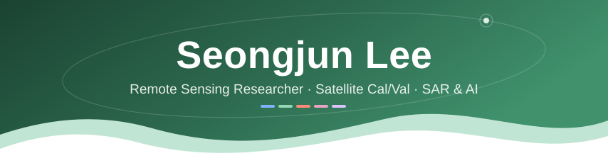

## 🛰️ About Me
**Remote sensing researcher** at the **National Institute of Forest Science (NIFoS)**, South Korea 🇰🇷

- 🌲 Working on **CAS500-4 Cal/Val**, running UAV multispectral and LiDAR field campaigns to validate agricultural and forestry satellite products
- 🌊 Research interests: **SAR-based flood mapping**, **deep learning for water quality prediction**, and **Earth observation**
- 🎓 M.S. in Earth Sciences and Environmental Engineering from **GIST** ([**HydroAI Lab**](https://hydroai.net/)), working on AI for hydrology and remote sensing

---

## 📝 Publications
**Journal articles (first author)**

1. **S. Lee** et al., "Enhancing Detection of Inundated Areas Using Novel Hybrid PolSAR-Metaheuristic-Deep Learning Models," *IEEE JSTARS*, 2026. [[DOI]](https://doi.org/10.1109/JSTARS.2026.3704360)
2. **S. Lee** et al., "Cross-Domain Flood Mapping with PolSAR-Informed Deep Learning in Data-Denied Regions: Evidence from Contrasting Hydroclimatic Regimes," *IEEE JSTARS*. *(under review)*
3. **S. Lee** et al., "A satellite-reanalysis deep-learning nationwide 1 km gridded inland water quality dataset for South Korea (2016-2024)," *Scientific Data*. *(under review)*

<b>Selected conference presentations</b>

- **S. Lee** and H. Kim, "Development of Chlorophyll-a Prediction Model for Inland Reservoirs Using Satellite and Land Surface Model: Applying Deep Learning Approach," *AGU 2024*, Washington, D.C., 2024. (Poster)
- **S. Lee** and H. Kim, "Advancing Deep Learning-Based Prediction of Water Quality for Inland Water," *Korea International Water Week 2024*, Daegu, 2024. (Oral)
- **S. Lee** and H. Kim, "Estimation of Inland Water Quality Indicators Using Satellite and Machine Learning," *COSPAR 2024*, Busan, 2024. (Poster)

---

## 🚀 Skills
### Languages
  

### Data & AI
      

### Remote Sensing & GIS
   -1F4E79?style=for-the-badge)   

### Field & UAV
     

### Tools & Environment
       

---

## 🖥️ Compute
     

---

## 📊 GitHub Activity
<picture>
  <source media="(prefers-color-scheme: dark)" srcset="https://raw.githubusercontent.com/SeongjunLee4473/SeongjunLee4473/output/github-stats-dark.svg" />
  <source media="(prefers-color-scheme: light)" srcset="https://raw.githubusercontent.com/SeongjunLee4473/SeongjunLee4473/output/github-stats.svg" />
  
</picture>

<picture>
  <source media="(prefers-color-scheme: dark)" srcset="https://raw.githubusercontent.com/SeongjunLee4473/SeongjunLee4473/output/github-snake-dark.svg" />
  <source media="(prefers-color-scheme: light)" srcset="https://raw.githubusercontent.com/SeongjunLee4473/SeongjunLee4473/output/github-snake.svg" />
  
</picture>

---

## 🍀 GitHub Farm

---

## 📞 Contacts
  

